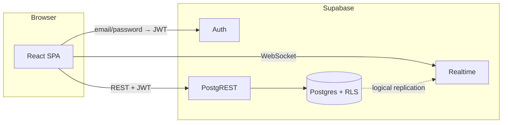
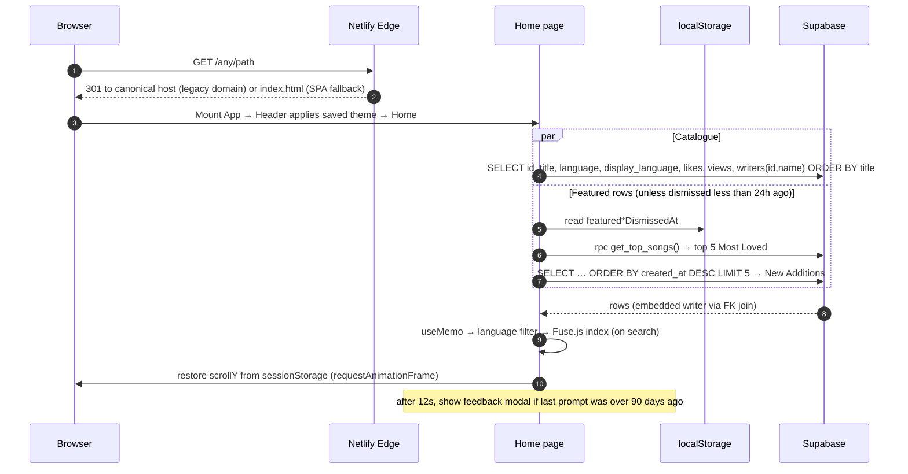
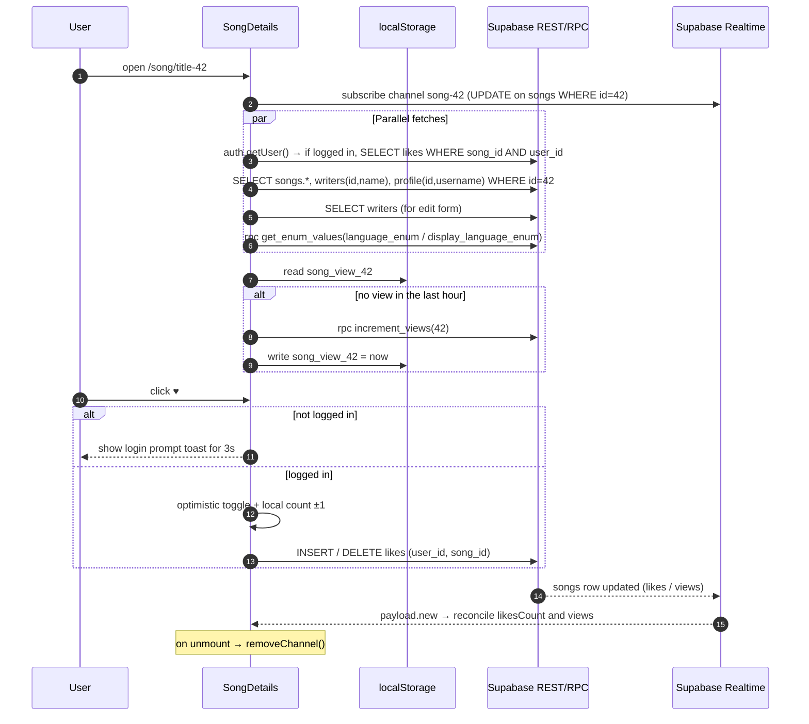
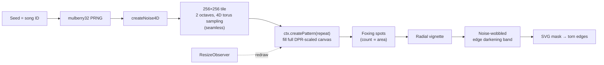

# Bashonu: Architecture Deep Dive

This document covers how Bashonu works internally: how requests move through the system, how state is managed, where data is cached, and how security and scale are handled. Everything here comes from the production codebase. Implementation code and credentials are intentionally left out.

---

## Table of Contents
1. [Architectural Style](#1-architectural-style)
2. [Deployment Topology](#2-deployment-topology)
3. [Routing & URL Design](#3-routing--url-design)
4. [Request Lifecycles](#4-request-lifecycles)
5. [State Management](#5-state-management)
6. [Storage & Caching Strategy](#6-storage--caching-strategy)
7. [Rendering Pipeline: Scripts, Fonts & Themes](#7-rendering-pipeline-scripts-fonts--themes)
8. [Security Model](#8-security-model)
9. [Performance & Scalability](#9-performance--scalability)
10. [Known Trade-offs & Roadmap](#10-known-trade-offs--roadmap)

---

## 1. Architectural Style

Bashonu is a **thick-client, Backend-as-a-Service (BaaS)** application:

- **No custom application server.** The React SPA calls Supabase directly through `@supabase/supabase-js`.
- **The database is the API.** PostgREST exposes tables as REST resources, and business operations that need atomicity or elevated logic, such as view counting, trending aggregation and role checks, run as **Postgres functions** called through `rpc()`.
- **Authorization lives in the database.** The client ships with a public, anonymous-role key (this is by design in Supabase). What a user can read or write is enforced by **Row-Level Security (RLS)** policies evaluated against `auth.uid()`, not by client code.

The main reason for this choice is that a solo developer gets **zero server maintenance and free-tier-friendly hosting**, while auth, data integrity and real-time updates still meet production standards.

---

## 2. Deployment Topology

| Layer | Technology | Responsibility |
|---|---|---|
| Build | **Vite 7** + `@vitejs/plugin-react` | ES-module bundling, asset hashing, HMR in development |
| Hosting / CDN | **Netlify** | Serves the static bundle and edge redirects |
| Edge rules | `_redirects` file | (a) **Forced 301** redirects from two legacy regional domains, including `www.` variants, to the canonical domain, keeping the path (`:splat`). (b) **SPA fallback**: `/* → /index.html 200`, so deep links like `/song/...` resolve on a hard refresh |
| Backend | **Supabase** (managed Postgres, Auth, Realtime) | Data, identity, change feeds |
| Third-party | YouTube iframe embeds, Google Fonts, Google Analytics | Media playback, typography, traffic analytics |

**SEO layer** (in the static `index.html`): meta description and keywords tuned for regional search terms, Open Graph tags, and **Schema.org `MusicPlaylist` JSON-LD** with a `sameAs` reference to a legacy domain, which tells crawlers the domains are the same entity.

---

## 3. Routing & URL Design

Client-side routing uses **React Router 7** (`BrowserRouter`):

| Route | Page | Auth |
|---|---|---|
| `/` | Home: catalogue, search, featured rows | Public |
| `/trending` | Top songs and top poets | Public |
| `/song/:slug` | Song details: lyrics, likes, corrections, YouTube | Public (likes need login) |
| `/poet/:slug` | Poet profile: bio, stanzas, songs | Public (edit for admins) |
| `/about` | Mission and links | Public |
| `/profile` | Login / sign-up, or dashboard and upload form | Mixed |
| `/my-songs` | The current user's uploads | Authenticated |
| `/reset-password` | Password recovery landing page | Recovery token |
| `/admin` | Feedback analytics and report moderation | Admin (`is_admin()`) |

### Slug strategy
URLs are generated as `<lowercased-ascii-title>-<numeric-id>`. Non-ASCII and punctuation characters are stripped, and whitespace is collapsed to hyphens.

- **Resolution only uses the trailing numeric ID**: the last `-` segment on song pages, or a `\d+$` regex on poet pages. The title portion is purely cosmetic and good for SEO.
- **Consequences:**
  - Renaming a song or poet **never breaks existing links**.
  - Titles written entirely in Arabic script reduce to just `-<id>`, which still resolves.
  - Bare-ID URLs (`/song/42`), used internally by *My Songs*, resolve correctly as well.

### Cross-page navigation state
- The *Upload Song* nav link passes `state: { openUpload: true }` through the router, so `/profile` opens with the upload form already expanded. No query string or global store is needed.
- Song cards are real `<a href>` elements, which keeps them crawlable and lets users middle-click or open in a new tab. Primary clicks are intercepted so the app can save scroll position before navigating client-side.

---

## 4. Request Lifecycles

### 4.1 Cold load → Home catalogue

**Main point:** the list query **never selects lyric columns**. Only lightweight metadata is fetched for the whole catalogue, and the full song row is fetched only on the details page.

### 4.2 Song details: view, like, realtime

**Edge cases handled:**
- **StrictMode double-mount**: a `useRef` flag makes sure `registerView` runs only once per mount, even when React 19 runs effects twice in development.
- **Like-status query**: uses `maybeSingle()`, and the "no rows" error (`PGRST116`) is treated as "not liked" rather than a failure.
- **Authoritative reconciliation**: optimistic like counts are overwritten by the server's value as soon as the Realtime UPDATE arrives, so any drift corrects itself. Other users viewing the same song see the change live as well.
- **YouTube URL normalisation**: `youtu.be/ID`, `watch?v=ID&…` and `/embed/ID` forms are all converted to a clean embed URL. Anything else is ignored rather than embedded.

### 4.3 Contribution (upload / edit)

1. The user authenticates with Supabase Auth (email and password). Sign-up confirms and returns to login, and *Forgot password* sends a recovery email whose redirect lands on `/reset-password`. That page listens for the `PASSWORD_RECOVERY` auth event and calls `updateUser({ password })`.
2. Client-side validation checks that the title, language and poet are set, and that **at least one** of `lyrics_roman` / `lyrics_arabic` is non-empty.
3. Poet resolution has three branches:
   - **Existing**: chosen from a live-filtered, searchable dropdown. It uses `onMouseDown` with `preventDefault` so the selection registers before the input's blur closes the list.
   - **New**: `INSERT writers … RETURNING id`, then that ID is used.
   - **Don't know**: resolves to the canonical *Unknown* writer row, so attribution stays a valid foreign key.
4. `INSERT songs` with `user_id = auth user`. Empty optional fields are stored as `NULL` rather than empty strings.
5. Editing is only offered when `currentUser.id === song.user_id`. Ownership is ultimately enforced by RLS.

### 4.4 Moderation

- **Corrections** are inserted into `song_reports` by any visitor, logged in or not. The default status is `pending`.
- **Admin view** (`/admin`): first calls `rpc is_admin()` and shows nothing until it returns `true`. Reports are listed oldest-first, giving a FIFO queue. Changing a report's status updates the row and **optimistically removes it from the current tab**. The selected view (feedback vs. reports) is remembered in `localStorage`.
- **Feedback analytics** are computed client-side over the filtered window: mean rating, per-star histogram and comments. Custom ranges are interpreted in the admin's **local time zone** and converted to ISO bounds.
- **Poet curation**: admins edit poet metadata (names in both scripts, years, region, bios) and manage *memorable stanzas* (`poet_verses`) inline on the poet page.

---

## 5. State Management

Bashonu **deliberately uses no global state library** (no Redux, Zustand or Context store). State is placed as follows:

| Concern | Mechanism | Rationale |
|---|---|---|
| Server data (songs, writers, reports) | Component-local `useState`, fetched on mount or when route params change | Each page owns its data, which avoids stale global caches |
| Derived views (filtered and searched lists, language chips, stats) | `useMemo` / computed during render | No duplicated state that can fall out of sync |
| Auth session | Supabase client (persisted session, auto refresh), read via `auth.getUser()` | The SDK is the single source of truth for identity |
| Theme (`light` → `paper` → `dark`) | `data-theme` attribute on `<html>` + `localStorage` | CSS custom properties re-theme the whole app with no React re-render cascade |
| Fullscreen lyrics | `lyrics-fullscreen-active` class on `<body>`, watched by a **`MutationObserver`** in the app shell | Lets a deeply nested page hide the global header without prop drilling or context |
| Live counters | Supabase Realtime subscription per song | Push-based consistency across all viewers |
| Cross-route intent | React Router `location.state` | Short-lived and needs no persistence |

The **DOM-as-message-bus** pattern (attributes and classes plus observers) keeps the component tree decoupled. Its main cost is that it is less explicit than a context provider, which is an acceptable trade-off at the current app size.

---

## 6. Storage & Caching Strategy

### 6.1 Client-side persistence

| Key | Store | TTL / Policy | Purpose |
|---|---|---|---|
| `theme` | localStorage | Persistent | Remember the user's theme |
| `song_view_<id>` | localStorage | **1 hour** | View-count throttle per song per browser |
| `featuredTrendingDismissedAt` | localStorage | **24 hours** | Hide "Most Loved" row after dismissal (and skip its RPC) |
| `featuredNewDismissedAt` | localStorage | **24 hours** | Hide "New Additions" row after dismissal (and skip its query) |
| `bashonu_feedback_last_submitted` | localStorage | **90 days** | Rate-limit the feedback prompt (set on submit *or* close) |
| `admin_dashboard_view` | localStorage | Persistent | Remember the admin's last dashboard tab |
| `homeScrollPosition` | sessionStorage | Read-once (deleted after restore) | Return to the exact list position after viewing a song |

Dismissal TTLs are also **request avoidance**: when a featured row is hidden, the network call that would populate it is never made.

### 6.2 Server-side data strategy
- **Denormalised counters.** `songs.likes` and `songs.views` are stored on the song row, so list pages can sort and display engagement **without aggregate joins**. Likes still exist as individual rows in `likes`, which keeps them auditable, one per user, and reversible. The counter column is the read-optimised projection.
- **Aggregations in the database.** Trending songs and poets are computed by Postgres functions and returned ready-ranked.
- **Enums as config.** `language_enum` / `display_language_enum` are read at runtime through `get_enum_values`, so the database schema is the single source of truth for allowed languages.

### 6.3 Static asset caching
- Vite emits **content-hashed** JS/CSS bundles, which are safe for long-lived CDN caching.
- Nastaliq / Naskh fonts (`Scheherazade New` in four weights, `Nafees Nastaleeq`, plus a dedicated Khowar font) are **self-hosted** in `/public/fonts`, which makes rendering of a niche script independent of third-party font CDNs. Google Fonts' *Noto Nastaliq Urdu* is the final fallback in the stack.

---

## 7. Rendering Pipeline: Scripts, Fonts & Themes

### Bidirectional text
- Lyrics are stored per script, so a **single document never mixes directions**. This avoids the classic BiDi rendering bugs from mixed RTL/LTR text.
- Free-text fields that may contain either script (correction reports, admin report previews, poet bios, stanzas) are checked at render time against Arabic-script Unicode blocks, and `direction` and `font-family` are switched accordingly.
- Typography is tuned per script: Nastaliq needs much more vertical room for its diagonal baseline, so line-height is `2.4` for Arabic script versus `1.8` for Latin.

### Theming
Three themes are driven entirely by CSS custom properties under `[data-theme="…"]`:
- **Light**: the default.
- **Dark**: inverted palette, and the header swaps to a dark-variant logo.
- **Paper**: lyrics are rendered on a **procedurally generated parchment canvas**. SVG **mask images** (`paper-mask.svg`, `paper-mask2.svg`) give the lyric card, script toggle and font controls torn, rough-paper silhouettes.

### PaperBackground pipeline

- **Determinism**: the same song always gets the same paper on every device and every visit, with no stored image.
- **Cost control**: the expensive per-pixel noise runs on 65,536 pixels (the tile), not on the full canvas, which can be millions of pixels on a retina phone. The full-resolution edge pass skips any pixel outside a 30 CSS-px border band.
- **Only rendered when needed**: the component mounts only while the Paper theme is active.

---

## 8. Security Model

| Area | Approach |
|---|---|
| **Credentials in the client** | Only Supabase's **public anon key** is shipped, which is expected for BaaS SPAs. No service-role key or private secret exists in the frontend. |
| **Authorization** | **Row-Level Security** in Postgres is the enforcement boundary. UI checks (owner-only *Edit*, admin-only buttons) are **UX affordances only**, and the database decides. |
| **Admin role** | Determined server-side by the `is_admin()` function, never by a client-editable flag or local storage. The admin route renders a "Checking access…" gate and then a lock screen for non-admins. |
| **Authentication** | Supabase Auth (email + password). Password recovery uses a time-limited email link with an explicit `redirectTo` back to the app. The reset page detects missing or expired recovery sessions and tells the user. |
| **Atomic mutations** | View counts are incremented server-side through RPC. Clients never write counter values directly. |
| **Likes integrity** | Modelled as `(user_id, song_id)` rows keyed to the authenticated session's user ID, which gives one reversible like per user per song. |
| **XSS** | All user content (lyrics, bios, reports) is rendered through React's escaped text nodes. There is no `dangerouslySetInnerHTML`. |
| **Embeds** | Only YouTube URLs that match known patterns are turned into iframe sources. Anything else is dropped. |
| **Input bounds** | Correction reports are capped at 2,000 characters client-side. Empty optional fields are normalised to `NULL`. |
| **Anonymous writes** | `feedback` and `song_reports` accept anonymous inserts by design, to keep friction low. Their contents are only shown in the admin dashboard. |

---

## 9. Performance & Scalability

**What scales well today**
- **Static delivery** from a CDN with hashed assets, so the app shell costs nothing per request at the origin.
- **Stateless backend**: Supabase handles connection pooling, auth and replication, and there's no app server to scale.
- **Narrow projections**: list views select only metadata columns, and lyrics are fetched one song at a time.
- **Server-side aggregation** for trending and atomic counters keeps heavy work in Postgres.
- **Realtime is scoped** to one row per open song page (`filter: id=eq.<id>`) and torn down on unmount.
- **Request avoidance** through localStorage TTLs (featured rows, view throttle, feedback prompt).
- **Passive scroll listeners** and `requestAnimationFrame`-timed scroll restoration avoid jank.

**Deliberate trade-offs at current scale**
- **Full-catalogue fetch + client-side fuzzy search.** For a regional archive (thousands of songs), one lightweight payload plus in-memory Fuse.js gives **instant, typo-tolerant search with no search infrastructure**. Fuse.js indexes are rebuilt when the query changes. This is cheap at this size and memoised against unrelated re-renders.
- **Per-page fetching without a shared query cache.** It's simpler to reason about, at the cost of re-fetching when moving between pages.

---

## 10. Known Trade-offs & Roadmap

| Area | Current | Planned evolution |
|---|---|---|
| Search | Client-side Fuse.js over full catalogue | Move to Postgres `pg_trgm` trigram similarity or full-text search with server-side pagination once the catalogue outgrows a single payload |
| Data fetching | Ad-hoc `useEffect` fetches | Adopt a query cache (e.g. TanStack Query) for deduplication, background refresh and cross-page caching |
| Theme sync | Polling `data-theme` on the song page | Replace with a `MutationObserver` or a small theme context |
| Paper renderer | Main-thread canvas | Move tile generation to an `OffscreenCanvas` in a Web Worker and debounce resize redraws |
| View throttling | Per-browser localStorage | Add server-side de-duplication (e.g. hashed fingerprint and time window) to resist scripted inflation |
| Moderation | Manual status changes | Link resolved reports to an edit history / audit trail on `songs` |
| SEO | Static meta in `index.html` | Per-song dynamic meta via pre-rendering or edge functions so each song is indexable with its own title |
| Bundle | Three icon libraries | Consolidate to one icon set and lazy-load admin / poet-editing routes |

---

← Back to the [README](./README.md)
