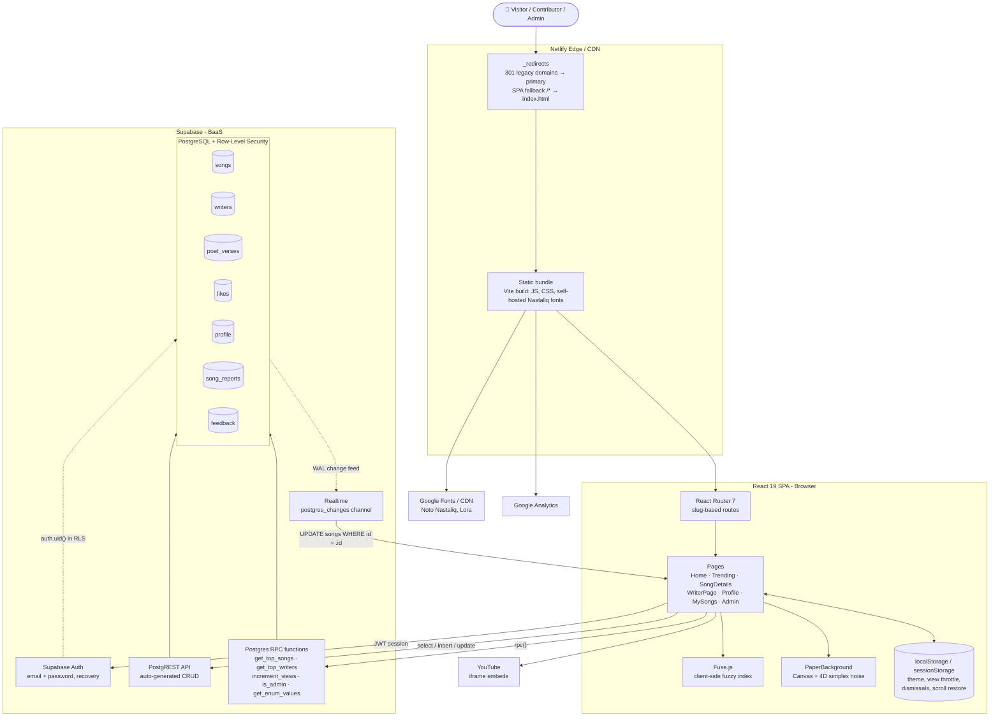
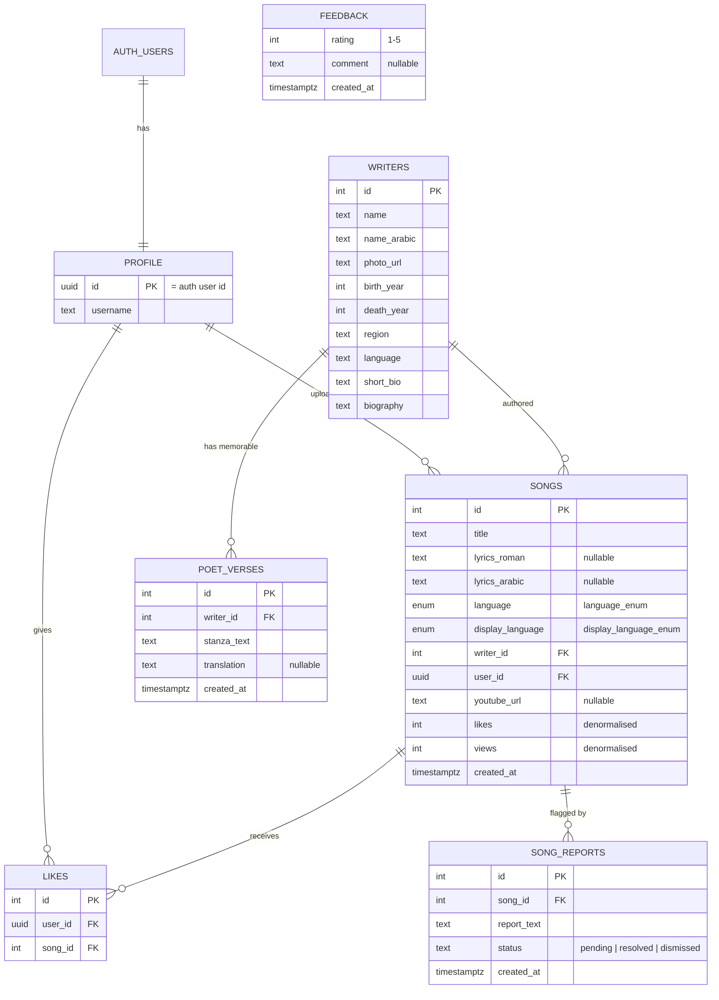
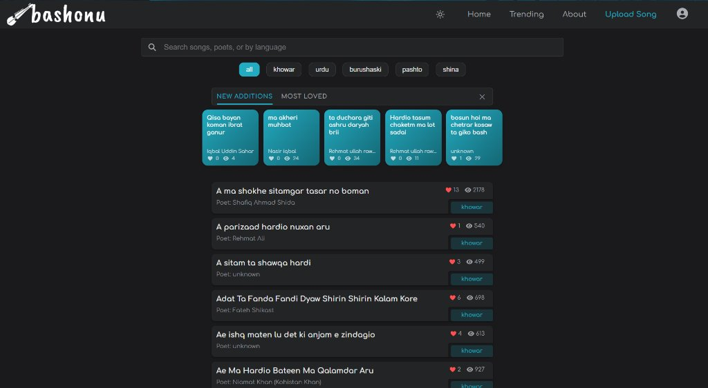
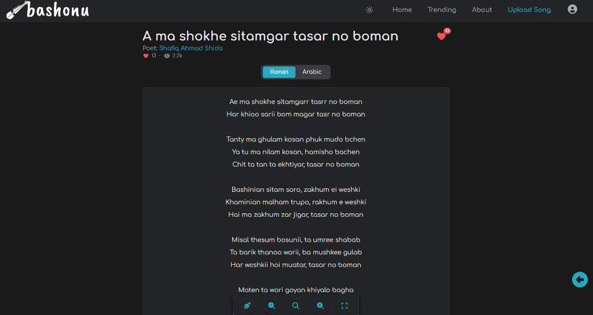
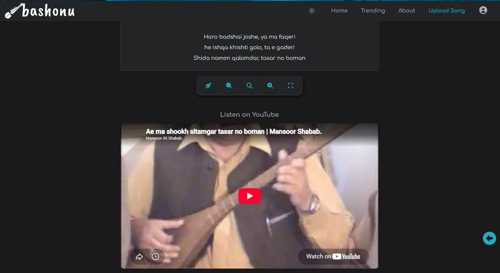
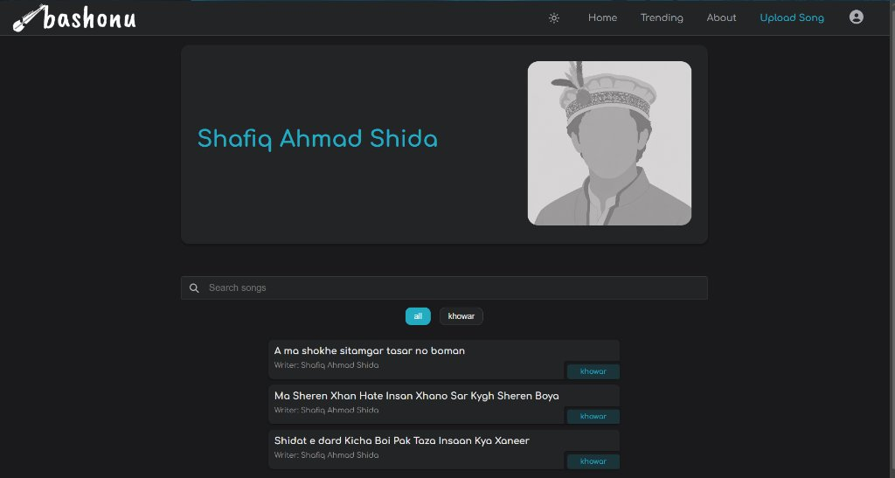

# 🎶 Bashonu

**A community-driven digital archive that preserves the endangered song lyrics of Chitral and Gilgit-Baltistan, in both Roman and Perso-Arabic (Nastaliq) script.**

[Live Site](#-demo--visuals) · [Architecture](./ARCHITECTURE.md) · [Request a Walkthrough](#-private-repository-notice)

---

## 📌 Problem & Motivation

The Khowar, Shina, Burushaski and other languages of northern Pakistan carry centuries of poetry and folk music, mostly passed down **orally**. That heritage is fading quickly, and there are real technical reasons why:

| Problem | Why it is hard |
|---|---|
| **No canonical written record** | Lyrics live in people's memories, WhatsApp forwards and YouTube comments, and nothing is searchable or attributed. |
| **Two competing writing systems** | The same song may be written in **Roman Urdu-style transliteration** or in **Perso-Arabic Nastaliq**, which is right-to-left and needs specialised fonts and line-heights to render properly. |
| **Inconsistent spelling** | Transliteration has no standard. "Bashonu", "Bashono" and "Bashunu" are all "correct", so exact-match search fails. |
| **Poet attribution is lost** | Many songs have unknown or disputed authorship, and poets' biographies aren't recorded anywhere. |
| **Crowd-sourced data quality** | Contributors are non-technical community members, so errors need a lightweight correction path that doesn't require an account. |

**Bashonu** fixes this with a crowd-sourced, bilingual-script lyrics archive. It has typo-tolerant search, poet profiles, engagement-based discovery, and an admin moderation pipeline, and it runs on a fully serverless stack.

---

## 🏗 System Architecture

Bashonu is a **serverless Single-Page Application**. The React client talks directly to Supabase, which provides Auth, an auto-generated REST layer over PostgreSQL, Postgres RPC functions, and Realtime change feeds. **Row-Level Security** policies on the database are the authorization boundary, so there's no custom application server.

> A deeper walkthrough of request lifecycles, state, caching and security lives in **[ARCHITECTURE.md](./ARCHITECTURE.md)**.

---

## ⚙️ Key Engineering Highlights

### 1. Dual-script lyrics model with automatic RTL detection
Each song has **two independent lyric columns**, one Roman and one Arabic-script. Contributors can submit either or both, and validation only requires at least one. The viewer:
- picks the default script from whichever columns are populated, and only shows a Roman ⇄ Arabic toggle when both exist,
- swaps font stacks (self-hosted *Scheherazade New* / *Nafees Nastaleeq* / *Noto Nastaliq Urdu*) and line-height (`2.4` for Nastaliq, `1.8` for Latin) per script,
- runs a Unicode range test (`U+0600–06FF`, `U+0750–077F`, `U+08A0–08FF`) on free-text inputs, such as correction reports and admin views, to switch `direction: rtl` and the font family **while the user types**.

### 2. Procedural "old-book paper" renderer: about 300× cheaper than per-pixel noise
The optional *Paper* theme renders a unique, aged parchment texture behind every song with a custom `<canvas>` component:
- **Seamless tiling via 4D noise on a torus.** It samples `simplex-noise` at `(cos u, sin u, cos v, sin v)`, so a 256×256 tile wraps with no visible seams. Two octaves at different radii give fine paper fibre plus coarse mottling.
- The tile is stamped across the full canvas with `ctx.createPattern()`, which is hardware-accelerated, instead of evaluating noise for every retina pixel.
- Foxing spots, a vignette and a **noise-modulated rough edge** are drawn once at full resolution on top, so they never visibly repeat.
- A **seeded PRNG (`mulberry32`) keyed on the song ID** makes every song's paper unique but deterministic: it looks the same on every visit and every device.
- The canvas is sized at `CSS px × devicePixelRatio` and redrawn through a `ResizeObserver`, so it stays crisp on high-DPI mobile screens.

### 3. Abuse-resistant engagement counters
- **Views** go through an `increment_views` RPC, so the counter is updated atomically server-side rather than with a read-modify-write from the client. A per-song timestamp in `localStorage` throttles each browser to **1 view per hour per song**, and a `useRef` guard stops React 19 StrictMode's double-invoked effects from counting twice.
- **Likes** are stored as rows in a `likes` join table (one per user per song) instead of a client-writable counter. The UI updates optimistically, and the authoritative denormalised `songs.likes` / `songs.views` values are pushed back to every open viewer through a **Supabase Realtime `postgres_changes` subscription** scoped to that one song's row.
- **Trending** rankings for songs and poets are computed in Postgres (`get_top_songs`, `get_top_writers`), which keeps aggregation off the client.

### 4. Typo-tolerant, weighted fuzzy search with no search server
The whole catalogue (lightweight columns only, never lyrics) is fetched once, and **Fuse.js** builds a weighted index over it: `title 0.5 · poet name 0.3 · language 0.1 · display language 0.1`, with `threshold 0.4` and `ignoreLocation`. This is enough to absorb inconsistent transliteration spelling. Language filter chips are **derived dynamically** from the data and applied *before* the fuzzy pass, which shrinks the search space. Everything is memoised with `useMemo` on `[songs, searchTerm, selectedLanguage]`.

### 5. Crowd-sourced data quality and moderation pipeline
- **Anonymous correction reports**: any visitor can flag errors on a song (capped at 2,000 characters, RTL-aware input) and they land in `song_reports` with status `pending`.
- **Admin dashboard**, gated by an `is_admin()` Postgres function rather than a client-side flag. It provides:
  - a moderation queue with **Pending / Resolved / Dismissed** tabs and optimistic removal on status change,
  - feedback analytics: average rating, 5-star distribution bars and comment feed, over preset or **custom local-time date ranges** (converted to ISO bounds `00:00:00 → 23:59:59`).
- **Rate-limited feedback prompt**: an NPS-style modal appears after 12 seconds, then stays away for **90 days** after submission or dismissal.
- **Poet attribution edge cases**: uploaders can pick an existing poet through a searchable dropdown, create a new poet inline, or choose **"Don't Know"**, which links to a canonical *Unknown* writer record instead of leaving the foreign key null.

### Also worth noting
- **Slug routing with ID suffix**: `/song/<title-slug>-<id>` gives SEO-friendly URLs, while the parser only reads the trailing numeric segment. Renaming a song never breaks old links, and bare-ID URLs still resolve.
- **Scroll restoration**: Home stores `scrollY` in `sessionStorage` before navigating and restores it with `requestAnimationFrame` once the list has rendered, so users return to the exact spot in a long list.
- **Distraction-free fullscreen lyrics**: a body class drives fullscreen mode, and a `MutationObserver` in the app shell hides the global header without needing a global state library.
- **Multi-domain SEO consolidation**: three regional domains are 301-redirected at the edge to one canonical host, backed by Open Graph tags and Schema.org `MusicPlaylist` JSON-LD.

---

## 🗄 Database / Data Model Overview

PostgreSQL (managed by Supabase). Postgres **enums** constrain language values, and the client loads them dynamically through an RPC, so adding a new language doesn't require a frontend deploy.

**Server-side functions (RPC):**

| Function | Purpose |
|---|---|
| `get_top_songs()` | Ranked trending songs with poet name, likes and views |
| `get_top_writers()` | Poets ranked by aggregate likes and views across their songs |
| `increment_views(song_id)` | Atomic view-counter increment |
| `is_admin()` | Role check used to gate the admin dashboard and poet editing |
| `get_enum_values(enum_name)` | Exposes Postgres enum members to populate form dropdowns |

---

## 🎬 Demo & Visuals

🌐 **Live deployment:** [bashonu.com](https://bashonu.com) <!-- Replace or confirm the live URL before publishing -->

### Screenshots

| Home: fuzzy search, language chips & discovery | Song view: Roman ⇄ Arabic script toggle & reader controls |
|:---:|:---:|
|  |  |

| Embedded YouTube playback & correction toolbar | Poet profile & attributed catalogue |
|:---:|:---:|
|  |  |

---

## 🔒 Private Repository Notice

The source code for Bashonu is kept in a **private repository** to protect the production infrastructure, the community-contributed dataset, and ongoing development. This showcase repo documents the architecture, design decisions and engineering trade-offs without exposing implementation code or credentials.

**Recruiters, researchers and potential collaborators are welcome to get in touch.** I'm happy to:
- give a **live walkthrough** of the codebase and architecture over a call, or
- grant **temporary read-only access** to the private repository for review.

📬 Contact: **[kashanali.akhsss@gmail.com](mailto:kashanali.akhsss@gmail.com)** · **[LinkedIn](https://www.linkedin.com/in/kashan-ali-khan)**

---

Built to keep the songs of the mountains alive. 🏔️

